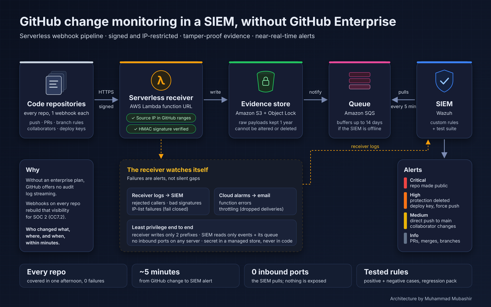

# GitHub Change Monitoring in a SIEM, without GitHub Enterprise

> Real-time alerts in Wazuh when someone makes a repo public, deletes branch protection, adds a deploy key or force-pushes to main.
> Serverless receiver on AWS, signed and IP-restricted, tamper-proof evidence, and a pipeline that alerts on its own failures.



---

## Why this exists

GitHub Enterprise can stream its audit log to a SIEM. On other plans, and on personal accounts, there is no audit log streaming at all. Without it, these questions have no real-time answer:

- Who just made a private repository **public**?
- Who **deleted the branch protection** on `main`?
- Who added a **deploy key with write access**?
- Who **force-pushed** over the default branch, or pushed straight to it without review?

Repository webhooks send these events in real time on every plan. This project turns them into a production-grade SIEM feed that you could hand to an auditor (built for a SOC 2 CC7.2 monitoring control).

| Capability | Without this | With this pipeline |
|---|---|---|
| Alert when a repo goes public / is transferred / deleted | ❌ | ✅ level 13 |
| Alert on branch protection or ruleset changes | ❌ | ✅ level 12 |
| Alert on deploy keys and force pushes to the default branch | ❌ | ✅ level 12 |
| Alert on direct pushes that skip review, collaborator changes | ❌ | ✅ level 10 |
| Tamper-proof copy of every event for auditors | ❌ | ✅ S3 Object Lock |
| Know when the monitoring itself breaks | ❌ | ✅ receiver alerts + CloudWatch alarms |

---

## How it works

```
GitHub repositories (one webhook each, HTTPS, HMAC-signed)
      ↓
AWS Lambda function URL — the receiver
   • accepts only GitHub's published "hooks" IP ranges   → else 403
   • verifies X-Hub-Signature-256 with a secret            → else 401
   • fails closed if the IP list can't be loaded           → 503
      ↓
Amazon S3 (Object Lock)  raw/    full payload, kept 1 year, cannot be altered
                         events/ small flat record for the SIEM
      ↓  (S3 event notification)
Amazon SQS — buffers up to 14 days if the SIEM is down
      ↓  (Wazuh aws-s3 module pulls every 5 min — no inbound ports anywhere)
Wazuh — custom rules 100700–100715 → prioritised alerts
      ↑
Receiver's own logs (CloudWatch Logs) → rules 100716–100721
CloudWatch alarms on Lambda Errors / Throttles → email
```

### Design choices

- **Serverless receiver, not a VM.** No server exposes a port to the internet. The SIEM only ever pulls.
- **Queue in the middle.** If Wazuh is restarting or down, events wait in SQS instead of being lost.
- **Evidence first.** The raw payload is written to S3 under Object Lock before anything else happens.
- **Cheapest check first.** The IP check runs before the signature check, so random internet traffic never causes a Secrets Manager read.
- **Fail closed.** If GitHub's IP list can't be loaded and no recent copy exists, every request is rejected.
- **Least privilege everywhere.** The receiver can write to two S3 prefixes and read one secret. The SIEM user can read the flat events and its own queue, never the raw payloads.
- **Monitor the monitor.** Rejected callers, bad signatures, receiver errors and throttling all raise alerts, so a silent failure can't hide a real change.

---

## What raises an alert

| Rule | Level | Event |
|---|---|---|
| 100711 / 100712 / 100713 | 13 | Repository made public / transferred / deleted |
| 100703 / 100705 | 12 | Branch protection rule / ruleset **deleted** |
| 100702 / 100704 | 12 | Branch protection rule / ruleset created or edited |
| 100709 / 100710 | 12 | Deploy key added or removed / **write-access** deploy key added |
| 100708 | 12 | Force push to the default branch |
| 100715 | 12 | Collaborator given admin |
| 100701 | 10 | Collaborator added, removed or changed |
| 100706 | 10 | Direct push to the default branch (not a PR merge) |
| 100714 | 7 | Repository created, renamed, archived, unarchived or made private |
| 100700 / 100707 | 3 | Any other event, and PR merges through the GitHub UI (logged, low priority) |

**Receiver health** (`github_webhook_receiver_rules.xml`):

| Rule | Level | Meaning |
|---|---|---|
| 100720 | 12 | Receiver failing closed: GitHub IP list unavailable, all deliveries rejected |
| 100719 | 12 | 3 invalid signatures in 10 min from one source |
| 100717 | 10 | Invalid signature from a GitHub IP (secret mismatch or forged request) |
| 100718 | 10 | 5 rejected requests in 10 min from one non-GitHub source |
| 100721 | 7 | GitHub IP list refresh failed (cached list still in use) |
| 100716 | 5 | Request from a non-GitHub IP rejected |

> Rule IDs are examples. Check they don't clash with your existing local rules (`grep -rn 'id="1007' /var/ossec/etc/rules/`) and renumber if needed.

---

## Repository layout

```
08-github-webhook-siem/
├── README.md
├── lambda/lambda_function.py           receiver (Python 3.12+, stdlib + boto3 only)
├── aws/
│   ├── lambda-role-policy.json         receiver: PutObject on 2 prefixes, 1 secret, own logs
│   ├── wazuh-reader-policy.json        SIEM: its queue, events/ only, receiver logs
│   └── sqs-queue-policy.json           only your bucket may send to the queue
├── wazuh/
│   ├── rules/github_webhook_rules.xml           event rules 100700–100715
│   ├── rules/github_webhook_receiver_rules.xml  receiver health rules 100716–100721
│   └── config/ossec_aws_s3_snippet.xml          SQS subscriber + CloudWatch Logs service
├── scripts/add_github_webhooks.sh      idempotent bulk rollout: dry run, canary, verify
├── tests/
│   ├── test_lambda.py                  11 offline unit tests for the receiver
│   ├── run_wazuh_tests.sh              wazuh-logtest runner (positive + negative cases)
│   ├── wazuh_event_cases.txt
│   └── wazuh_receiver_cases.txt
└── docs/architecture.svg / .png
```

---

## Prerequisites

- An AWS account and an admin-level AWS CLI for the one-time setup
- Wazuh 4.x manager with the `aws-s3` module (installed by default) and the AWS CLI credentials file for a read-only IAM user
- GitHub CLI (`gh`) and a token for the repository owner with webhook admin rights
  - classic token: `admin:repo_hook`
  - fine-grained token: **Webhooks: Read and write** on **All repositories**
- `openssl`, `zip` (or Python), `curl`

> **Using a GitHub organization?** An organization webhook covers every repo in one place and is simpler. This project targets the cases where that isn't available (personal accounts) or where you want per-repo control. The rules work the same either way.

---

## Setup

Set these once in your shell. Change the names to suit you.

```bash
export AWS_REGION=us-east-1
ACCOUNT=$(aws sts get-caller-identity --query Account --output text)
BUCKET=my-github-webhook-events        # must be globally unique
QUEUE=github-webhook-events
FN=github-webhook-receiver
SECRET=github-webhook-secret
```

### 1. Create the webhook secret

```bash
aws secretsmanager create-secret --name "$SECRET" \
  --secret-string "$(openssl rand -hex 32)" --query ARN --output text
```

Never print it or put it in code. You'll paste it into GitHub only for the first manual test, and the rollout script reads it directly.

### 2. Create the evidence bucket (Object Lock)

```bash
aws s3api create-bucket --bucket "$BUCKET" --object-lock-enabled-for-bucket
# (outside us-east-1 add: --create-bucket-configuration LocationConstraint=$AWS_REGION)

aws s3api put-object-lock-configuration --bucket "$BUCKET" --object-lock-configuration \
  '{"ObjectLockEnabled":"Enabled","Rule":{"DefaultRetention":{"Mode":"GOVERNANCE","Days":365}}}'

aws s3api put-public-access-block --bucket "$BUCKET" --public-access-block-configuration \
  BlockPublicAcls=true,IgnorePublicAcls=true,BlockPublicPolicy=true,RestrictPublicBuckets=true

aws s3api put-bucket-lifecycle-configuration --bucket "$BUCKET" --lifecycle-configuration \
  '{"Rules":[{"ID":"expire-after-retention","Status":"Enabled","Filter":{},"Expiration":{"Days":395},"NoncurrentVersionExpiration":{"NoncurrentDays":1}}]}'
```

### 3. Create the queue and connect it to the bucket

```bash
QURL=$(aws sqs create-queue --queue-name "$QUEUE" --attributes \
  MessageRetentionPeriod=1209600,VisibilityTimeout=120,SqsManagedSseEnabled=true \
  --query QueueUrl --output text)

sed -e "s/REGION/$AWS_REGION/g; s/ACCOUNT_ID/$ACCOUNT/g; s/YOUR_QUEUE_NAME/$QUEUE/g; s/YOUR_BUCKET/$BUCKET/g" \
  aws/sqs-queue-policy.json > /tmp/qpolicy.json
aws sqs set-queue-attributes --queue-url "$QURL" --attributes \
  Policy="$(python3 -c 'import json;print(json.dumps(json.load(open("/tmp/qpolicy.json"))))')"

aws s3api put-bucket-notification-configuration --bucket "$BUCKET" --notification-configuration \
  "{\"QueueConfigurations\":[{\"Id\":\"github-events-to-sqs\",\"QueueArn\":\"arn:aws:sqs:$AWS_REGION:$ACCOUNT:$QUEUE\",\"Events\":[\"s3:ObjectCreated:*\"],\"Filter\":{\"Key\":{\"FilterRules\":[{\"Name\":\"prefix\",\"Value\":\"events/\"}]}}}]}"
```

Only `events/` triggers the queue. The raw copies are evidence and never go to the SIEM.

### 4. Create the receiver's IAM role

```bash
aws iam create-role --role-name "$FN-role" --assume-role-policy-document \
  '{"Version":"2012-10-17","Statement":[{"Effect":"Allow","Principal":{"Service":"lambda.amazonaws.com"},"Action":"sts:AssumeRole"}]}'

sed -e "s/REGION/$AWS_REGION/g; s/ACCOUNT_ID/$ACCOUNT/g; s/YOUR_BUCKET/$BUCKET/g; s/YOUR_SECRET_NAME/$SECRET/g; s/YOUR_FUNCTION_NAME/$FN/g" \
  aws/lambda-role-policy.json > /tmp/lpolicy.json
aws iam put-role-policy --role-name "$FN-role" --policy-name least-privilege \
  --policy-document file:///tmp/lpolicy.json

aws logs create-log-group --log-group-name "/aws/lambda/$FN"
aws logs put-retention-policy --log-group-name "/aws/lambda/$FN" --retention-in-days 90
```

### 5. Deploy the receiver

```bash
cd lambda && zip -q ../function.zip lambda_function.py && cd ..
sleep 10   # let the new role propagate

aws lambda create-function --function-name "$FN" --runtime python3.13 --architectures arm64 \
  --handler lambda_function.lambda_handler --zip-file fileb://function.zip \
  --role "arn:aws:iam::$ACCOUNT:role/$FN-role" --memory-size 256 --timeout 15 \
  --environment "Variables={BUCKET=$BUCKET,SECRET_ID=$SECRET}"
aws lambda put-function-concurrency --function-name "$FN" --reserved-concurrent-executions 5

aws lambda create-function-url-config --function-name "$FN" --auth-type NONE
aws lambda add-permission --function-name "$FN" --statement-id FunctionURLPublic \
  --action lambda:InvokeFunctionUrl --principal "*" --function-url-auth-type NONE
aws lambda add-permission --function-name "$FN" --statement-id FunctionURLInvoke \
  --action lambda:InvokeFunction --principal "*" --invoked-via-function-url

URL=$(aws lambda get-function-url-config --function-name "$FN" --query FunctionUrl --output text)
```

A public function URL needs **both** permission statements. With only the first, the URL returns 403. Never add the second one without `--invoked-via-function-url`, because that would allow anyone to invoke the function directly. If your CLI is too old for that flag, add it in the console: Lambda → Configuration → Permissions → Add permissions → Function URL.

**Check it** (from your own machine, which is not a GitHub IP):

```bash
curl -s -o /dev/null -w 'POST %{http_code}\n' -X POST -H 'Content-Type: application/json' -d '{}' "$URL"   # 403
curl -s -o /dev/null -w 'GET %{http_code}\n' "$URL"                                                      # 405
```

### 6. Alarm on receiver failures

```bash
TOPIC=$(aws sns create-topic --name "$FN-alarms" --query TopicArn --output text)
aws sns subscribe --topic-arn "$TOPIC" --protocol email --notification-endpoint you@example.com   # confirm the email
for M in Errors Throttles; do
  aws cloudwatch put-metric-alarm --alarm-name "$FN-$M" \
    --alarm-description "$FN $M >= 1 in 5 min (GitHub deliveries may be lost)" \
    --namespace AWS/Lambda --metric-name $M --dimensions Name=FunctionName,Value=$FN \
    --statistic Sum --period 300 --evaluation-periods 1 --threshold 1 \
    --comparison-operator GreaterThanOrEqualToThreshold --treat-missing-data notBreaching \
    --alarm-actions "$TOPIC"
done
```

GitHub does **not** retry a failed delivery on its own. These alarms tell you when to redeliver.

### 7. Give Wazuh read-only access

Create a dedicated IAM user for Wazuh. Don't reuse a broad read-only user.

```bash
aws iam create-user --user-name wazuh-github-reader
sed -e "s/REGION/$AWS_REGION/g; s/ACCOUNT_ID/$ACCOUNT/g; s/YOUR_QUEUE_NAME/$QUEUE/g; s/YOUR_BUCKET/$BUCKET/g; s/YOUR_FUNCTION_NAME/$FN/g" \
  aws/wazuh-reader-policy.json > /tmp/wpolicy.json
aws iam put-user-policy --user-name wazuh-github-reader --policy-name github-events-read \
  --policy-document file:///tmp/wpolicy.json
aws iam create-access-key --user-name wazuh-github-reader   # put these in /root/.aws/credentials on the Wazuh manager (chmod 600)
```

### 8. Configure Wazuh

On the Wazuh manager, **back up first**:

```bash
sudo cp -p /var/ossec/etc/ossec.conf /var/ossec/etc/ossec.conf.bak-$(date +%Y%m%d)
```

1. Add the two blocks from `wazuh/config/ossec_aws_s3_snippet.xml` inside your existing `<wodle name="aws-s3">` (create one if you don't have it). Replace `YOUR_QUEUE_NAME` and `YOUR_FUNCTION_NAME`.
2. Install the rules:
   ```bash
   sudo cp wazuh/rules/github_webhook_rules.xml wazuh/rules/github_webhook_receiver_rules.xml /var/ossec/etc/rules/
   sudo chown root:wazuh /var/ossec/etc/rules/github_webhook*.xml && sudo chmod 640 /var/ossec/etc/rules/github_webhook*.xml
   ```
3. Test before restarting:
   ```bash
   sudo /var/ossec/bin/wazuh-analysisd -t        # no output = config OK
   sudo tests/run_wazuh_tests.sh                 # expect all PASS and 100718 on the 5th rejection
   ```
4. Restart and watch the module:
   ```bash
   sudo systemctl restart wazuh-manager
   sudo grep -E 'Subscriber fetch|cloudwatchlogs|ERROR|AccessDenied' /var/ossec/logs/ossec.log | tail
   ```

### 9. Test on one repository by hand

In one test repository go to **Settings → Webhooks → Add webhook**:

- **Payload URL:** your function URL
- **Content type:** `application/json`
- **Secret:** copy it from Secrets Manager in the console
- **SSL verification:** enabled
- **Events:** select individual events: *Branch or tag creation, Branch or tag deletion, Branch protection rules, Collaborator add/remove/changed, Deploy keys, Pull requests, Pushes, Repositories, Repository rulesets*

In **Recent Deliveries** the ping should return **202**. Then create a branch protection rule and delete it. Within about 5–10 minutes Wazuh should show **100702** followed by **100703**.

### 10. Roll out to every repository

```bash
read -rs GH_TOKEN; export GH_TOKEN        # paste the token; it stays in this shell only
gh api user --jq .login                    # must print the repo owner

./scripts/add_github_webhooks.sh --owner YOUR_ACCOUNT --ref-repo YOUR_TEST_REPO                 # dry run
./scripts/add_github_webhooks.sh --owner YOUR_ACCOUNT --ref-repo YOUR_TEST_REPO --apply --limit 3   # canary
./scripts/add_github_webhooks.sh --owner YOUR_ACCOUNT --ref-repo YOUR_TEST_REPO --apply         # everything
./scripts/add_github_webhooks.sh --owner YOUR_ACCOUNT                                           # verify: all "exists (… last 202)"
unset GH_TOKEN
```

What the script does:

- **Checks before changing anything:** it confirms which GitHub user it's acting as, that the Function URL looks right, and (with `--ref-repo`) that your test repo already has the same hook and events.
- **Never duplicates:** it creates hooks only where none points at your URL. Existing hooks are reported as `exists`, or as `exists-drift` if their settings differ, and are never modified.
- **Keeps the secret out of sight:** it sends the secret to `gh` on stdin, never on the command line or in logs.
- **Writes a log:** each run saves `webhook_rollout_<UTC time>.tsv`, which is useful evidence for auditors.

---

## Testing

| What | How | Expected |
|---|---|---|
| Receiver logic (offline) | `python3 -m unittest tests/test_lambda.py -v` | 11 tests OK |
| Wazuh rules | `sudo tests/run_wazuh_tests.sh` | all PASS |
| Non-GitHub caller | 5× `curl -X POST` from your machine | 403 ×5 → Wazuh 100716 then **100718** |
| Bad signature | add a second webhook on a test repo with a wrong secret, then delete it | GitHub shows 401 → Wazuh **100717** |
| Delivery-failure alarm | `aws cloudwatch set-alarm-state --alarm-name $FN-Errors --state-value ALARM --state-reason test` | email arrives |
| End to end | create and delete a branch protection rule on the test repo | Wazuh 100702 then 100703 |

Keep destructive cases (making a repo public, transfer, delete, force push) to `wazuh-logtest` only.

---

## Operating it

- **New repositories don't get a hook automatically.** Run the script in dry-run mode on a schedule (for example weekly) and alert on any repo shown as `would add` or `exists-drift`, or on a last delivery code other than 202.
- **Redeliver after a failure.** Find the failed delivery under Settings → Webhooks → Recent Deliveries and click **Redeliver**. Using the API:
  ```bash
  gh api "repos/OWNER/REPO/hooks/HOOK_ID/deliveries?per_page=30" | grep -oE '"id":[0-9]+,"guid":"[^"]+"'
  gh api -X POST repos/OWNER/REPO/hooks/HOOK_ID/deliveries/DELIVERY_ID/attempts
  ```
  Delivery IDs are large integers. Read them from the raw JSON as shown. Passing them through `--jq` rounds them and gives you the wrong ID.
- **Tune noise.** If a bot account pushes directly to a default branch by design, add a child rule of 100706 at level 3 for that sender. Keep the exception narrow, give it an owner and a review date.

---

## Lessons learned (gotchas)

- **Match Wazuh rules on fields, never on text.** A `<match>github-webhook</match>` rule under the AWS parent also caught CloudTrail events that mentioned the function's name.
- **Give AWS SDK clients short timeouts.** boto3's defaults (60 s connect and read, plus retries) made one cold-start request hit the Lambda time limit. `connect_timeout=2, read_timeout=3, total_max_attempts=2`, plus 256 MB of memory, fixed it.
- **Null fields are dropped by the Wazuh JSON decoder.** Write rules that match present values, not empty ones.
- **Watch for bracketed paste.** Some terminals add `ESC[200~ … ESC[201~` around pasted text, so `read -rs` captures a token 12 characters too long. Strip it with `GH_TOKEN=${GH_TOKEN#$'\e[200~'}; GH_TOKEN=${GH_TOKEN%$'\e[201~'}`.
- **Fine-grained tokens show no scopes header.** Test permissions by calling the endpoint, for example `gh api repos/OWNER/REPO/hooks`.
- **Expect a security scanner finding.** Prowler and similar tools flag a public Lambda function URL. That's expected here. Mute that one check for this one function and record the compensating controls (IP allowlist, HMAC, least privilege, alarms).

---

## Known limits

- **Latency is about 2–10 minutes**, set by the Wazuh pull interval (5 min).
- **Throttled deliveries are not retried by GitHub.** Size the reserved concurrency for your push volume and watch the Throttles alarm.
- **Org- and account-level events** (logins, token changes) are not repository webhook events. Export the account security log for those.

## Cost

For most teams, a few dollars a month or less: Lambda invocations, S3 storage for small JSON files, and SQS requests. All software used is open source.
